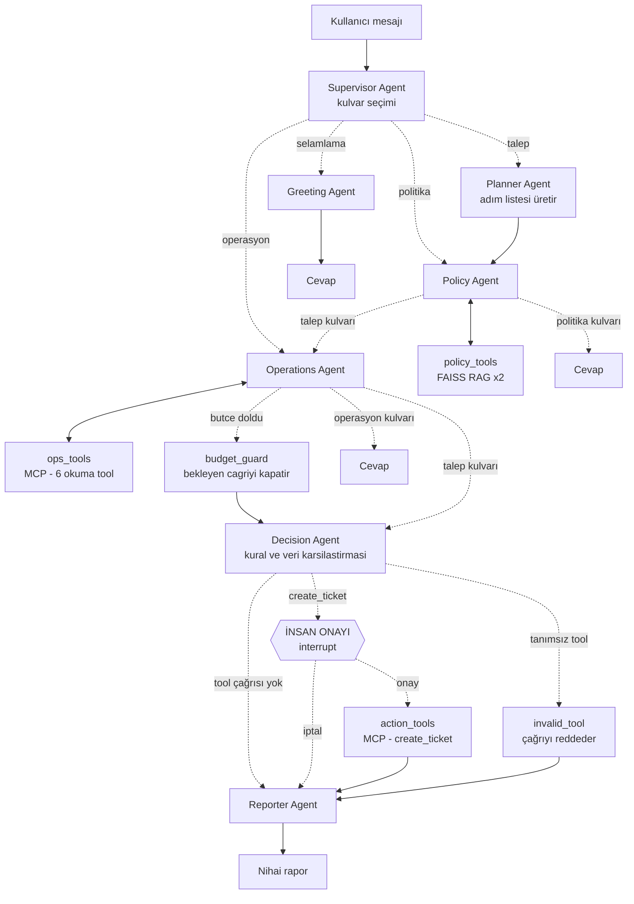
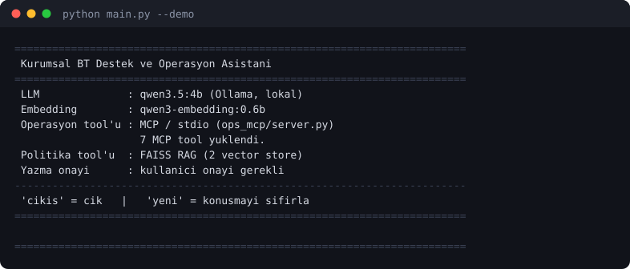
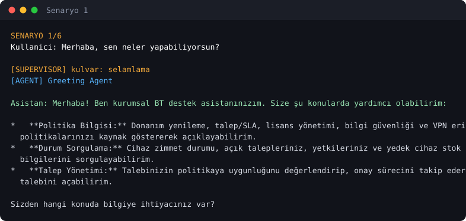
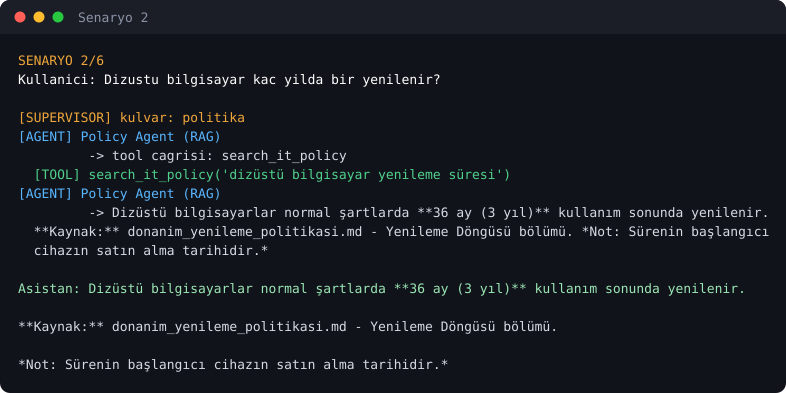
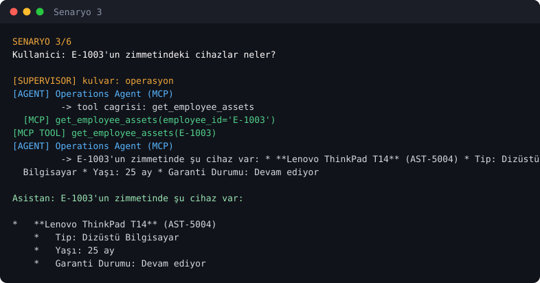
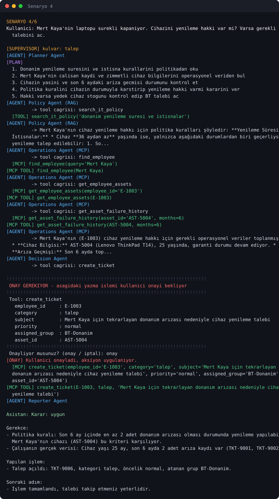
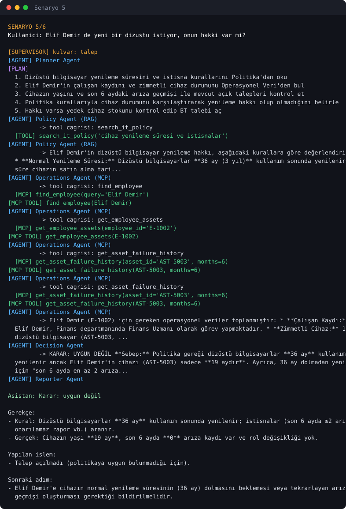
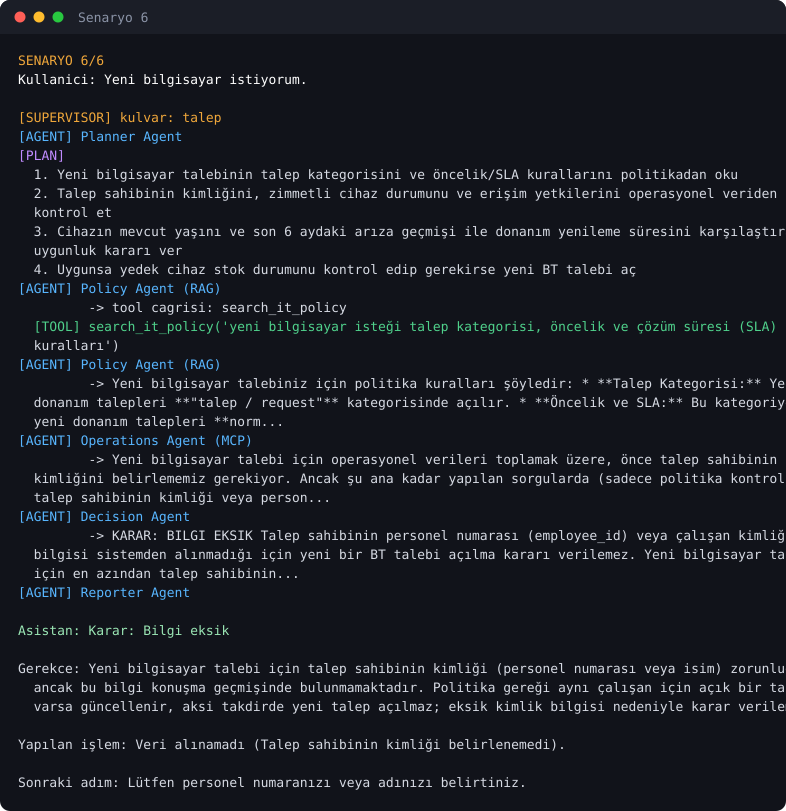

# Kurumsal BT Destek ve Operasyon Asistanı

> Agentic AI Bootcamp — Kapanış Projesi

Çalışanların doğal dille yazdığı BT taleplerini **şirket politikaları ile kurumsal
sistemdeki güncel veriyi birlikte değerlendirerek** sonuçlandıran, çok adımlı ve
araç kullanan bir agent sistemi. Agent yalnızca cevap üretmez; karar verir ve
kullanıcı onayıyla kurumsal sistemde **aksiyon alır**.

---

## 1. Çözülen problem

Kurumsal BT destek masasının günlük yükünün büyük kısmı tek bir soruyla
cevaplanamayan taleplerden oluşur. Tipik bir örnek:

> "Mert Kaya'nın laptopu sürekli kapanıyor. Cihazını yenileme hakkı var mı?
> Varsa gerekli BT talebini aç."

Bu isteği sonuçlandırmak için bir destek uzmanının yapması gerekenler:

1. Donanım yenileme politikasını açıp **yenileme süresini ve istisnalarını** okumak
2. Çalışanı personel sisteminde bulmak
3. Zimmetindeki cihazı ve **cihazın kaç aylık olduğunu** öğrenmek
4. Cihazın **son 6 aydaki arıza kayıtlarını** saymak
5. Politikadaki eşiği çalışanın gerçek verisiyle karşılaştırıp **karar vermek**
6. Karar olumluysa yedek cihaz stoğunu kontrol edip **doğru kategori, öncelik ve
   atama grubuyla talep açmak**

Bilgi iki ayrı yapıda ve iki ayrı yerde durur: politikalar **serbest metin
dokümanlarda**, çalışan/cihaz/arıza/stok verisi ise **ilişkisel veritabanında**.
Hiçbiri tek başına yeterli değildir — karar ikisinin kesişiminde doğar.

### Neden agentic AI? Tek bir LLM çağrısı neden yetmez?

Bu, projenin tasarımını belirleyen soru olduğu için açıkça cevaplanmayı hak ediyor:

| Gereksinim | Tek LLM çağrısıyla | Bu projede |
|---|---|---|
| Politika metnini getirmek | Modelin hafızasından uydurması gerekir | RAG ile dokümandan okunur, kaynak gösterilir |
| Çalışanın gerçek verisi | Modelde yoktur, erişemez | MCP tool'ları ile canlı sistemden çekilir |
| Hangi verinin gerekli olduğu | Soruya göre değişir, sabit prompt yetmez | Planner adımları belirler, agent tool'u kendi seçer |
| Adımların birbirine bağlılığı | Cihaz ID'si bilinmeden arıza geçmişi sorgulanamaz | Agent önceki tool sonucunu sonraki çağrıda kullanır |
| Karar üretmek | Metin üretir, kural uygulamaz | Decision Agent eşiği gerçek veriyle karşılaştırır |
| Sistemde değişiklik yapmak | Yapamaz | Onay kapısından geçen `create_ticket` yazma aksiyonu |
| Eksik bilgi | Varsayım yapar | Agent tool çağırmayı bırakıp soru sorar |

Kritik nokta **4. satır**: adımlar birbirine bağımlıdır. Cihazın arıza geçmişini
sorgulamak için önce çalışanı bulup cihaz kimliğini öğrenmek gerekir. Bu zincir
önceden sabit bir akışa yazılamaz, çünkü kullanıcının ne sorduğuna göre değişir.
Kararı modelin vermesi gerekir — bu da tanımı gereği agentic bir problemdir.

Buna karşılık **her soru agentic değildir.** "Parolam kaç karakter olmalı?"
sorusunda tek bir RAG araması yeterlidir. Bu yüzden sistem her isteği aynı ağır
akıştan geçirmez; Supervisor Agent isteği dört kulvara ayırır ve yalnızca
gerçekten çok adımlı olan `talep` kulvarı planlama + karar + aksiyon zincirini
çalıştırır.

---

## 2. Mimari



Grafiğin LangGraph tarafından üretilen gerçek hâli: [`docs/graph.mmd`](docs/graph.mmd)

### Veri kaynakları ve erişim yolları

```
                        Supervisor Agent
                               │
             ┌─────────────────┴─────────────────┐
             ▼                                   ▼
      POLİTİKA (RAG)                    OPERASYONEL VERİ (MCP)
    in-process FAISS                  custom FastMCP server (stdio)
             │                                   │
     ┌───────┴────────┐              ┌───────────┼───────────┐
     ▼                ▼              ▼           ▼           ▼
 it_policy     security_policy    çalışan      cihaz /     stok /
 16 chunk        10 chunk         / yetki    arıza geçmişi  talep
     │                │                       │
     └────────┬───────┘                       │
              ▼                               ▼
    data/policies/*.md                 ops_mcp/it_ops.db
    (5 politika dokümanı)                  (SQLite)
```

### Eğitimde öğrenilen hangi yaklaşım nerede kullanıldı?

| Yaklaşım | Bu projedeki yeri |
|---|---|
| **LangGraph `StateGraph`** | `graph.py` — 13 node, koşullu kenarlar |
| **Supervisor + specialist agent** | `agents/supervisor_agent.py` + 6 specialist |
| **Tool calling (`bind_tools`)** | Policy, Operations ve Decision agent'ları |
| **`ToolNode`** | `policy_tools`, `ops_tools`, `action_tools` |
| **RAG (FAISS + embedding)** | `tools/policy_tools.py`, iki ayrı vector store |
| **Hafıza (`InMemorySaver`)** | `thread_id` başına konuşma geçmişi; takip sorularını çözer |
| **Custom MCP server (FastMCP)** | `ops_mcp/server.py` — 7 MCP tool |
| **MCP client** | `tools/__init__.py` — `MultiServerMCPClient`, stdio |
| **Lokal LLM (Ollama)** | `config.py` — `qwen3.5:4b`, API anahtarı gerekmez |
| **`.env` ile yapılandırma** | `config.py` — model, yol, davranış; sır kodda yok |

### Eğitim projelerinin üstüne eklenenler

1. **Planner Agent** — isteği tool'lara dokunmadan önce açık bir adım listesine
   çevirir; plan sonraki agent'ların prompt'una brief olarak enjekte edilir.
2. **Decision Agent** — bilgi getirmeyi bırakıp *karar* üretir: politika eşiğini
   çalışanın gerçek değeriyle yan yana koyar (`kural 36 ay, cihaz 25 ay`).
3. **İnsan onay kapısı** — LangGraph `interrupt()` ile yazma aksiyonu öncesi
   durur; onay/iptal ikisi de doğru biçimde ele alınır.
4. **MCP + yedek yol** — MCP server başlatılamazsa agent doğrudan SQLite'a düşer
   ve bunu kullanıcıya söyler; cevap vermeyi reddetmez.
5. **Değerlendirme harness'ı** — `eval/run_eval.py`, 10 senaryoyu gerçek graph
   üzerinde çalıştırıp kulvar/içerik/**yasaklı ifade** kontrolü yapar.
6. **Ajan başına döngü bütçesi** — `MAX_POLICY_LOOPS` ve `MAX_OPS_LOOPS`
   ayrıdır. Tek ortak sayaç kullanıldığında Policy Agent'ın turları Operations
   Agent'ın bütçesini tüketiyor ve veri toplanmadan karara geçiliyordu.
7. **Uydurma tool koruması** — model var olmayan bir tool adı üretirse
   `invalid_tool` node'u çağrıyı reddedip cevaplar; bu çağrı onay kapısına
   **ulaşamaz**. (Geliştirme sırasında gerçekten yaşandı: model `search_employee`
   diye olmayan bir tool uydurdu ve onay kapısını tetikledi.)
8. **Kimlik doğrulayan tool'lar** — `get_asset_failure_history` önce cihazın
   var olduğunu doğrular. Doğrulamasız hâlinde, model `asset_id`'yi tahmin
   ettiğinde tool "0 arıza" dönüyordu; bu da sağlıklı bir cihazdan ayırt
   edilemiyor ve kararı yanlış tarafa çeviriyordu. Olmayan kimlik artık hata
   döner ve doğru kimliği nasıl alacağını söyler.

---

## 3. Kullanılan teknolojiler

| Teknoloji | Kullanım amacı | Neden bu seçildi |
|---|---|---|
| **Python 3.11+** | Uygulama dili | — |
| **LangGraph** | Agent orkestrasyonu, state, checkpoint, interrupt | Koşullu kenarlar ve insan onayı (`interrupt`) için hazır altyapı; `create_react_agent` tek döngüye sıkışırken burada kulvarlar ayrılabiliyor |
| **LangChain Core** | Tool arayüzü, mesaj tipleri | `@tool` dekoratörü ile aynı fonksiyonlar hem MCP hem lokal yolda kullanılabiliyor |
| **Ollama + `qwen3.5:4b`** | LLM (lokal) | API anahtarı ve kota gerektirmez; projeyi başka bir makinede çalıştırmak için sadece `ollama pull` yeterli. Kurumsal BT verisinin dışarı çıkmaması da bu projenin kendi güvenlik politikasına uygun |
| **`qwen3-embedding:0.6b`** | RAG embedding (lokal) | Türkçe politika metinlerinde yeterli; aynı Ollama sunucusunda çalışır |
| **FAISS** | Vector store | Dosya tabanlı, sunucu gerektirmez, repoda yeniden üretilebilir |
| **MCP + FastMCP** | Operasyonel veriye standart protokolle erişim | Veritabanı tool'ları agent'a gömülü değil; aynı MCP server başka bir istemci tarafından da kullanılabilir |
| **SQLite** | Operasyonel veri (çalışan, cihaz, talep, yetki, stok) | Kurulum gerektirmez, repoda tek komutla üretilir |
| **python-dotenv** | Yapılandırma | Model adı, yollar ve davranış anahtarları `.env`'de |

### Model seçimi hakkında dürüst not

`qwen3.5:4b` 4 milyar parametreli bir modeldir. Tool seçimi ve Türkçe üretimde
yeterlidir, ancak tarih aritmetiği gibi işleri güvenilir yapmaz. Bu yüzden
türetilmiş değerler **modelden değil Python'dan** gelir: cihaz yaşı (`yas_ay`),
garanti durumu ve 6 aylık pencere içindeki arıza sayısı
`ops_mcp/database.py` içinde hesaplanıp agent'a hazır verilir. Agent'ın işi
hesap yapmak değil, hesaplanmış değeri politika kuralıyla karşılaştırmaktır.

---

## 4. Kurulum

### Gereksinimler

- Python 3.11 veya üzeri
- [Ollama](https://ollama.com) (lokalde çalışır durumda)

### Adımlar

**1. Depoyu klonlayın ve sanal ortamı kurun**

```bash
git clone <repo-url>
cd it-ops-agent
python -m venv venv
source venv/bin/activate      # Windows: .\venv\Scripts\Activate.ps1
pip install -r requirements.txt
```

**2. Ollama modellerini indirin**

```bash
ollama pull qwen3.5:4b
ollama pull qwen3-embedding:0.6b
```

Kontrol:

```bash
ollama list
```

**3. Yapılandırmayı hazırlayın**

```bash
cp .env.example .env
```

`.env` varsayılan değerlerle çalışır; harici bir API anahtarı gerekmez.

**4. Operasyonel veritabanını oluşturun**

```bash
python ops_mcp/create_database.py
```

**5. Politika vector store'larını oluşturun**

```bash
python scripts/01_create_vector_db.py
```

**6. Asistanı başlatın**

```bash
python main.py
```

MCP server'ı elle başlatmanız gerekmez — agent onu stdio üzerinden kendi
başlatır. Hazır senaryoları sırayla görmek için:

```bash
python main.py --demo
```

### Sorun giderme

**Cevaplar aşırı yavaşladıysa:** Ollama modeli varsayılan olarak tek eşzamanlı
slotla (`-np 1`) çalışır. Yarıda durdurulmuş bir istek bu slotu meşgul
bırakabilir ve sonraki çağrılar kuyruğa girer. Modeli boşaltmak sorunu çözer:

```bash
ollama stop qwen3.5:4b
```

**`Vector store bulunamadi` hatası:** `python scripts/01_create_vector_db.py`
çalıştırılmamış. Politika dokümanlarını değiştirdiyseniz de yeniden çalıştırın.

**`Veritabani bulunamadi` hatası:** `python ops_mcp/create_database.py`
çalıştırılmamış. Aynı komut demo verisini başlangıç durumuna da döndürür.

---

## 5. Proje yapısı

```
it-ops-agent/
├── main.py                     # CLI: etkileşimli sohbet ve --demo modu
├── graph.py                    # LangGraph kurulumu, kulvarlar ve yönlendiriciler
├── state.py                    # Ortak AssistantState
├── config.py                   # .env okuma, LLM ve embedding istemcileri
│
├── agents/
│   ├── supervisor_agent.py     # Mesajı dört kulvardan birine yönlendirir
│   ├── planner_agent.py        # Çok adımlı isteği adım listesine çevirir
│   ├── policy_agent.py         # RAG tool'ları ile politika okur
│   ├── ops_agent.py            # MCP tool'ları ile operasyonel veri okur
│   ├── decision_agent.py       # Kural ile veriyi karşılaştırır, karar verir
│   ├── approval_node.py        # Yazma aksiyonu öncesi insan onay kapısı
│   ├── invalid_tool_node.py    # Uydurulmuş tool çağrılarını reddeder
│   ├── budget_guard_node.py    # Bütçe dolunca bekleyen çağrıları kapatır
│   ├── reporter_agent.py       # Çok adımlı akışın nihai raporunu yazar
│   └── greeting_agent.py       # Selamlama ve yetenek özeti
│
├── tracing.py                  # Terminal iz kaydı (hangi agent, hangi tool)
│
├── tools/
│   ├── __init__.py             # MCP yükleme + yedek yola düşme kararı
│   ├── policy_tools.py         # search_it_policy, search_security_policy
│   └── ops_tools.py            # MCP tool'larının lokal SQLite karşılıkları
│
├── ops_mcp/
│   ├── server.py               # Custom FastMCP server (7 MCP tool)
│   ├── database.py             # SQLite erişim katmanı + türetilmiş alanlar
│   └── create_database.py      # Şema ve örnek veri
│
├── data/policies/              # 5 politika dokümanı (RAG kaynağı)
├── scripts/
│   ├── 01_create_vector_db.py  # FAISS vector store'ları üretir
│   ├── render_svg.py           # Terminal çıktısını SVG'ye çevirir
│   └── 03_build_screenshots.py # Demo transkriptinden ekran görüntüleri
├── eval/
│   ├── eval_set.json           # 10 değerlendirme senaryosu
│   └── run_eval.py             # Harness
├── tests/                      # Çevrimdışı testler (LLM/ağ kullanmaz)
│   ├── test_database.py        # Veri katmanı ve türetilmiş alanlar
│   └── test_routing.py         # Yönlendirme ve yazma aksiyonu korumaları
└── docs/
    ├── graph.mmd               # LangGraph'ın ürettiği gerçek diyagram
    └── screenshots/
```

---

## 6. MCP tool'ları

`ops_mcp/server.py` yedi tool sunar. Altısı salt okuma, biri yazma:

| Tool | İşlevi |
|---|---|
| `find_employee` | Çalışanı personel numarası veya adıyla bulur |
| `get_employee_assets` | Zimmetli cihazları, `yas_ay` ve garanti durumuyla getirir |
| `get_asset_failure_history` | Cihazın son N aydaki arıza sayısını getirir |
| `get_employee_tickets` | Çalışanın BT taleplerini getirir |
| `get_employee_entitlements` | Erişim yetkilerini (VPN, ERP, Jira) getirir |
| `get_spare_stock` | Yedek cihaz stoğunu getirir |
| `create_ticket` | **Yazma.** Yeni BT talebi açar — onay kapısından geçer |

Yazma tool'u graph'ta ayrı bir node'da (`action_tools`) tutulur ve ona giden tek
yol onay kapısından geçer. Agent'ın onayı atlayarak yazma yapması mimari olarak
mümkün değildir.

---

## 7. Hata ve belirsizlik yönetimi

| Durum | Davranış |
|---|---|
| MCP server başlatılamıyor | Doğrudan SQLite yoluna düşer, başlangıç ekranında bunu yazar |
| Ollama kapalı / model yok | İstek yakalanır, kullanıcıya ne kontrol edeceği söylenir |
| Vector store oluşturulmamış | Tool, hangi komutun çalıştırılacağını söyleyen hata metni döner |
| Olmayan çalışan / cihaz | Tool `"bulunamadi"` döner, agent uydurmaz |
| Aynı ada sahip iki çalışan | Tool aday listesi döner, agent hangisi olduğunu sorar |
| Çalışan kimliği belirtilmemiş | Agent tool çağırmaz, tek soruyla kimliği ister |
| Geçersiz kategori/öncelik | Tool geçerli değerleri listeleyerek reddeder |
| Model aynı tool'da döngüye girdi | Ajan başına döngü bütçesi devreye girer, toplanan veriyle ilerler |
| Bütçe dolduğunda bekleyen tool çağrısı | `budget_guard` çağrıyı kapatır, geçmiş tutarlı kalır |
| Model cihaz/çalışan kimliği uydurdu | Tool kaydın varlığını doğrular, hata ve doğru kullanım ipucu döner |
| Model olmayan bir tool adı uydurdu | `invalid_tool` çağrıyı reddeder, onay kapısına ulaşmaz |
| Model kaçak üretime girdi | `LLM_MAX_OUTPUT_TOKENS` cevabı sınırlar |
| Kullanıcı onayı vermedi | Talep açılmaz; model geçmişine "onaylanmadı" kaydı düşer |
| Politikada madde yok | Agent "dokümanlarda bu konuda madde bulunmuyor" der |

---

## 8. Testler ve kod kalitesi

Testler tamamen **çevrimdışı** çalışır: ne LLM çağrısı ne ağ erişimi yapar.
Test edilenler, modelin ne ürettiğinden bağımsız olarak tutması gereken
kurallardır — yönlendirme mantığı, yazma aksiyonunun önündeki korumalar ve veri
katmanının türettiği değerler.

```bash
pip install -r requirements-dev.txt
pytest -q          # 30 test
ruff check .       # lint
ruff format --check .
```

Test paketi, veritabanını geçici bir dizine kurar; projenin kendi
`ops_mcp/it_ops.db` dosyasına dokunmaz.

Öne çıkan birkaç test:

| Test | Neyi koruyor |
|---|---|
| `test_unknown_asset_is_an_error_not_zero_failures` | Tahmin edilen cihaz kimliğinin "arıza yok" gibi görünmesi (kararı çeviren hata) |
| `test_an_invented_tool_name_never_reaches_the_approval_gate` | Uydurulmuş tool çağrısının yazma onayı istemesi |
| `test_ops_budget_is_independent_of_policy_budget` | Ortak sayacın veri toplamayı yarıda kesmesi |
| `test_spent_ops_budget_closes_the_pending_call` | Cevaplanmamış tool çağrısıyla sonraki ajana geçilmesi |
| `test_find_employee_reports_ambiguity_instead_of_guessing` | Aynı isimden iki kişi varken birini seçmek |

---

## 9. Değerlendirme (eval harness)

```bash
python eval/run_eval.py
```

10 senaryo gerçek graph üzerinde çalışır ve üç şey kontrol edilir:
doğru kulvar seçildi mi, cevap içermesi gereken olguları içeriyor mu, ve
**içermemesi gerekeni içermiyor mu**. Üçüncüsü en önemlisi: reddedilmesi veya
netleştirilmesi gereken bir istekte uydurma talep numarası üretmek, bu tür bir
asistanda en kritik hata türüdür. Senaryolar onay vermez, bu yüzden
değerlendirme veritabanını değiştirmez.

**İlk koşu 7/10 verdi ve bu üç başarısızlık işe yaradı.** İkisi gerçek
kusurdu ve kodda düzeltildi: Supervisor, mevcut bir yetkinin durumunu sormayı
ağır `talep` kulvarına yönlendiriyordu (3 saniyelik iş 30 saniye sürüyordu), ve
Policy Agent bir cihaz talebinde yenileme/uygunluk kuralları yerine onay
hiyerarşisini getirdiği için Decision Agent yanlış kurala dayanıp talep açmaya
kalkıyordu. Üçüncüsü testin kendi kusuruydu: cevabın soru işareti içermesini
şart koşuyordu, oysa test edilmesi gereken şey agent'ın kimliği sorması.
Benzer biçimde bir başka senaryo cevapta "yok" kelimesini arıyordu; agent
"erişim yetkisi kayıtlı değil" diyordu — doğru cevap, yanlış ölçüt. Bu iki
ölçüt davranışa bakacak biçimde değiştirildi, kod değiştirilmedi.

Son koşunun sonucu: **10/10**. Ham çıktı: [`eval/last_run.json`](eval/last_run.json)

| Senaryo | Sonuç | Kulvar | Süre | Not |
|---|---|---|---|---|
| `politika-yenileme-suresi` | geçti | politika | 3.9s | — |
| `politika-parola` | geçti | politika | 3.4s | — |
| `politika-usb` | geçti | politika | 3.5s | — |
| `operasyon-zimmet` | geçti | operasyon | 3.1s | — |
| `operasyon-yetki-yok` | geçti | operasyon | 2.8s | — |
| `operasyon-stok` | geçti | operasyon | 2.3s | — |
| `talep-istisna-uygun` | geçti | talep | 33.9s | — |
| `talep-uygun-degil` | geçti | talep | 29.9s | — |
| `belirsiz-talep` | geçti | talep | 15.6s | — |
| `olmayan-calisan` | geçti | operasyon | 1.9s | — |

---

## 10. Geliştirme sırasında yakalanan hatalar

Bu bölüm, sistemin neden bu şekilde kurulduğunu açıklıyor. Aşağıdakilerin hepsi
uçtan uca koşularda gerçekten yaşandı ve kod bunlara göre düzeltildi.

**1. Agent, veri toplamadan karara geçiyordu.**
Operations Agent `talep` kulvarında hiç tool çağırmıyor, onun yerine Policy
Agent'ın cevabını özetliyordu. Uzun mesaj geçmişi, küçük bir modelin odağından
asıl görevi düşürüyor. Çözüm: her çağrıda sona eklenen, state'e yazılmayan bir
**yönerge mesajı** (`TALEP_DIRECTIVE`). Aynı sorun Decision ve Reporter
agent'larında da çıktı, aynı yöntemle çözüldü.

**2. Ortak döngü sayacı veri toplamayı kesiyordu.**
Tek bir `tool_loops` sayacı vardı. Policy Agent'ın turları bütçeyi tüketince
Operations Agent tam kritik veriyi çekeceği anda guard tarafından kesiliyordu.
Çözüm: ajan başına ayrı bütçe (`MAX_POLICY_LOOPS=3`, `MAX_OPS_LOOPS=6`).

Buna bağlı ikinci bir kusur: bütçe dolduğunda akış, **cevaplanmamış bir tool
çağrısıyla** sonraki ajana geçiyordu. Tool çağrısı olup sonucu olmayan bir
geçmiş tutarsızdır ve Decision Agent'ın boş cevap vermesinin nedeni buydu.
Çözüm: `budget_guard` node'u bekleyen her çağrıyı "bütçe doldu" sonucuyla
kapatır, sonraki ajan tutarlı bir geçmiş görür.

**3. Model olmayan bir tool adı uydurdu ve onay kapısını tetikledi.**
Decision Agent `search_employee` diye bir tool çağırdı. `decision_router` her
tool çağrısını onay kapısına yönlendirdiği için, var olmayan bir çağrı için
kullanıcıdan yazma onayı istendi. Çözüm: yalnızca gerçek yazma tool'u onay
kapısına gider; diğerleri `invalid_tool` node'unda reddedilip cevaplanır.

**4. Olmayan cihaz kimliği "arıza yok" gibi görünüyordu.**
Model, `get_employee_assets` sonucunu beklemeden `asset_id`'yi tahmin etti.
`get_asset_failure_history` o kimliği doğrulamadığı için `ariza_sayisi: 0`
döndü — bu da sağlıklı bir cihazdan ayırt edilemiyor ve kararı yanlış tarafa
çeviriyordu. Çözüm: tool önce kaydın varlığını doğrular, yoksa hata ve doğru
kullanım ipucu döner. Ayrıca prompt'lardan somut kimlik örnekleri kaldırıldı,
çünkü model örneği birebir kopyalıyordu.

**5. `except ... as error` bloğu dışında `error` kullanımı.**
MCP başlatılamadığında devreye girecek yedek yol, Python'da `except` bloğu
bitince `error` adının silinmesi nedeniyle `NameError` ile patlıyordu — yani
hata yönetiminin kendisi hatalıydı. `ruff` yakaladı; yapı, `AsyncExitStack` ile
`yield`'i `try` dışına alacak biçimde yeniden yazıldı.

**6. Politika dokümanının kendisi çelişkiliydi.**
Agent, Mert Kaya senaryosunda "UYGUN DEĞİL" dedi ve gerekçe olarak politikadaki
"garanti kapsamı devam eden cihazlar yenilenmez" cümlesini gösterdi — hâlbuki
istisna maddesi "son 6 ayda 2 arıza varsa yenilenir" diyordu. İki madde
birbiriyle çakışıyordu ve agent'ın gerekçesi savunulabilirdi. Hata modelde
değil **veride** olduğu için doküman düzeltildi: istisnaların garanti
durumundan öncelikli olduğu açıkça yazıldı.

**7. Ollama tek slotla çalışırken yarıda kesilen istekler sunucuyu kilitliyor.**
Paralel koşular ve yarıda durdurulan süreçler sonrası basit bir çağrı 116
saniye sürdü (üretim hızı normalken). `ollama stop <model>` ile çözüldü. Bu bir
uygulama hatası değil, geliştirme ortamı notudur ve kurulum bölümünde
hatırlatılır.

---

## 11. Ekran görüntüleri

Aşağıdaki görüntülerin tamamı `python main.py --demo` komutunun **gerçek
terminal çıktısıdır**; `scripts/03_build_screenshots.py` ile transkriptten
üretilir, elle düzenlenmez. Ham transkript:
[`docs/screenshots/demo_transcript.txt`](docs/screenshots/demo_transcript.txt)

Renkler izi okunur kılar: turuncu = Supervisor kararı, mavi = çalışan agent,
mor = plan, yeşil = tool çağrısı, kırmızı = onay kapısı.

**Başlangıç — aktif transport ve yapılandırma**



**Greeting Agent — yetenek özeti**



**Policy Agent — RAG ile politika sorgusu, kaynak göstererek**



**Operations Agent — MCP tool'u ile zimmet sorgusu**



**Çok adımlı talep — plan, RAG, MCP zinciri, karar, insan onayı, talep açma**



**Aynı soru, politikaya uymayan çalışan için — talep reddi**



**Belirsiz talep — agent tool çağırmak yerine soru soruyor**



---

## 12. Sınırlar ve bilinçli kapsam dışı bırakılanlar

- **Veri kurgu.** `ops_mcp/create_database.py` içindeki çalışan, cihaz ve talep
  kayıtları örnek veridir; politika eşiklerinin üç farklı sonuç üretmesi için
  (uygun / istisna ile uygun / uygun değil) bilinçli olarak seçilmiştir.
- **Tek kullanıcı.** Kimlik doğrulama yoktur; kullanıcı kim adına sorduğunu
  yazar. Gerçek kurulumda bu SSO kimliğinden gelirdi.
- **Hafıza oturum içindedir.** `InMemorySaver` süreç kapanınca sıfırlanır.
  Kalıcı hafıza için LangGraph'ın SQLite checkpointer'ına geçmek yeterlidir.
- **Tek dilli.** Politikalar ve prompt'lar Türkçedir.
